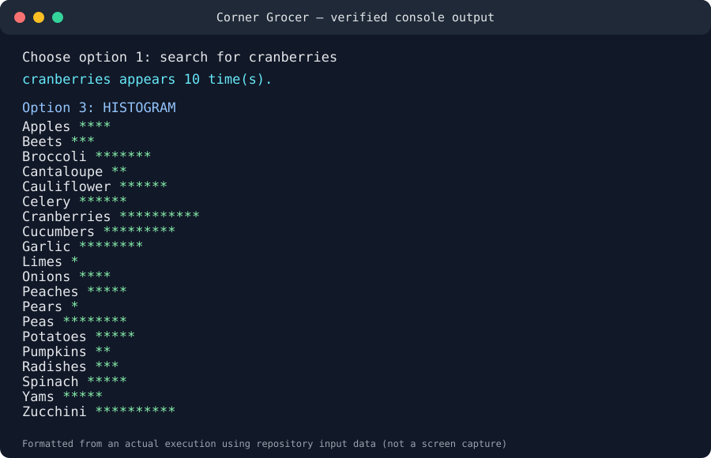
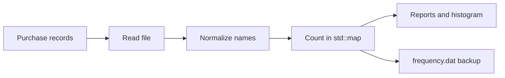

# Corner Grocer — Item Frequency Analyzer

**C++ · File I/O · Data aggregation · Command-line reports**  
*SNHU CS 210 academic project*

A grocery store can use purchase records to understand product demand. I developed this C++ application to read transaction data from a text file, count occurrences of each item, and display results through a simple console menu.

## Verified example output



The sample above is **formatted from a real run** of the C++ code with the included dataset, not a screenshot of a terminal. Searching for `cranberries` returned **10 occurrences**. The program also produced a histogram and wrote its frequency backup to `frequency.dat`.

## Features

- Search for an item's purchase frequency (case-insensitive).
- List every unique item and its frequency.
- Display a histogram using asterisks.
- Automatically write a frequency backup file when the program starts.
- Navigate using a four-option text menu.

## Data flow



## Build and run

Use a C++17-compatible compiler. These commands were checked with `g++` against the original repository source and dataset.

```bash
git clone https://github.com/Fernando-2/CS210-portfolio.git
cd CS210-portfolio
g++ -std=c++17 -Wall -Wextra -pedantic main.cpp GroceryTracker.cpp -o corner-grocer
./corner-grocer
```

Keep `CS210_Project_Three_Input_File.txt` in the **current working directory**. On Windows with MinGW-w64, use `-o corner-grocer.exe` and run the resulting executable.

Select **1** for an item lookup, **2** for all frequencies, **3** for a histogram, or **4** to exit.

## Repository map

| File | Purpose |
| --- | --- |
| [main.cpp](main.cpp) | Program entry point, menu, and input handling |
| [GroceryTracker.h](GroceryTracker.h) | Tracker interface and frequency maps |
| [GroceryTracker.cpp](GroceryTracker.cpp) | File loading, counting, reports, backup output |
| [CS210_Project_Three_Input_File.txt](CS210_Project_Three_Input_File.txt) | Supplied purchase-record dataset |
| [docs/reflection.md](docs/reflection.md) | Original course portfolio reflection |

## What I learned

I practiced parsing records, using Standard Library collections, organizing logic in a class, handling file operations, and presenting data in a readable format. Potential improvements include trimming whitespace and validating menu input more strictly.

[GitHub profile](https://github.com/Fernando-2) · [Portfolio](https://frflux.com)
